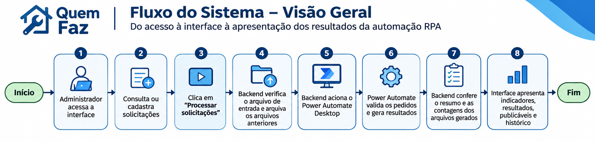

# Quem Faz · Módulo administrativo de validação com RPA

**Global Solution 2026 · FIAP · Robotic Process Automation · CitizenTech**

Interface administrativa (PHP) + API (Python/FastAPI) integradas ao fluxo
**`QuemFaz_Validacao_Pedidos`** do **Microsoft Power Automate Desktop**. O administrador vê as
solicitações recebidas, aciona o RPA real com um botão, acompanha as etapas comprovadas e
consulta resultados, pedidos aptos para publicação e auditoria. Ninguém precisa abrir CSV.

```
Interface PHP → Backend Python → Power Automate Desktop → CSVs → Backend Python → Interface PHP
```

> **Nada é simulado na aplicação.** Os indicadores são calculados dos arquivos gravados pelo
> RPA. A conclusão só é aceita quando o próprio fluxo grava o resumo do lote e os três arquivos
> conferem entre si. Python **não** reimplementa as regras de validação.

## Integrantes

| Integrante | RM |
|---|---|
| Enzo Vazquez Sartorelli | RM94618 |
| Kaue Pastori Teixeira | RM98501 |
| Nicolas Nogueira Boni | RM551965 |
| Guilherme Brazioli | RM98237 |
| Pedro Oliveira Valotto | RM551445 |

## Arquitetura e evidências

O navegador carrega as páginas PHP e consulta a API FastAPI por JavaScript. A API aciona
o fluxo local `Quem_Faz_RPA`, acompanha a execução e lê os CSVs gravados pelo robô.
Os pedidos e resultados ficam em CSV; os registros internos de execução ficam em JSON.



- [Fluxo geral do sistema](docs/fluxograma_sistema.png)
- [Documentação detalhada do Power Automate e fluxogramas Mermaid](power-automate/documentacao/fluxo_power_automate.md)
- [Exportação textual do fluxo](power-automate/export%20fluxo/GS_quem_faz_Automate.txt)
- [Imagens e evidências](assets/)
- [Amostra de log com dados fictícios](logs/amostras/historico_execucao_exemplo.csv)
- [Testes automatizados e dados de teste](tests/)
- [Registro da execução dos testes](tests/evidencias/pytest_simulados_2026-11-12.txt)

O Python está organizado em `backend/`. A pasta `src/` foi dispensada nesta entrega,
conforme a organização adotada pelo grupo.

## Status

| Item | Situação |
|---|---|
| Frontend PHP (6 telas) | ✅ funcionando (PHP 8.3) |
| API FastAPI + Swagger | ✅ funcionando |
| Testes automatizados (simulados) | ✅ 63 aprovados |
| **Execução real com o PAD** (modo `interface_grafica`) | ✅ comprovada em 11/11/2026: 11 pedidos, 4/5/1/1, 4 publicáveis |
| Modo `assistido` | ✅ implementado (testes simulados) |
| Modo `atalho` | ⚙️ implementado; requer configurar o atalho nas propriedades do fluxo ([documentação](power-automate/documentacao/fluxo_power_automate.md)) |
| Tratamento de falhas | ✅ blocos de erro no PAD e conferência de conclusão no backend ([documentação](power-automate/documentacao/fluxo_power_automate.md)) |

## Telas

| Tela | Conteúdo |
|---|---|
| **Dashboard** | Total, pendentes, aprovados, reprovados, duplicados, ignorados; último processamento; situação da automação; distribuição; resumo por categoria; execuções recentes |
| **Solicitações recebidas** | `pedidos_entrada.csv` com busca, filtros, detalhes, cadastro de solicitação de teste e restauração do lote de 11 pedidos (edição bloqueada durante o RPA) |
| **Processamento RPA** | Botão **PROCESSAR SOLICITAÇÕES**, modo definido na configuração, diagnóstico, etapas comprovadas, evidências reais, indicador indeterminado (sem % fictício) |
| **Resultados** | `pedidos_processados.csv` em abas Aprovados/Reprovados/Duplicados/Ignorados, com justificativa e exportação |
| **Pedidos publicáveis** | `pedidos_publicaveis.csv` com filtros por categoria e bairro, exibido como "Apto para publicação" |
| **Logs e auditoria** | Execuções (ID, modo, status final, motivo da falha) e histórico do RPA atual ou arquivado |

## Como executar

### Pré-requisitos (Windows)

- Python **3.11+**
- PHP **8.2+** (`winget install PHP.PHP.8.3`, ou o zip oficial de https://windows.php.net extraído em `tools\php\`)
- Power Automate Desktop instalado, com sessão iniciada, e o fluxo importado de
  [exportação textual em `power-automate/`](power-automate/export%20fluxo/GS_quem_faz_Automate.txt)
- Os CSVs ficam **dentro do projeto**: `dados\` (entrada), `resultados\` e `logs\` (saídas do RPA)

### 1. Instalar

```powershell
py -3 -m venv .venv
.venv\Scripts\python.exe -m pip install -r backend\requirements.txt
```

Isso cria `.venv` e instala as dependências de `backend/requirements.txt`.

### 2. Conferir a configuração no código

Os valores da apresentação estão definidos diretamente em `backend/config.py` e
`frontend/config/config.php`. Não é necessário criar arquivo de ambiente.

| Configuração | Onde ajustar |
|---|---|
| `pasta_base` | `backend/config.py`: por padrão, a raiz do projeto (mesma pasta de `pastadoprojeto` no fluxo) |
| `nome_fluxo` | `backend/config.py`: nome **exato** em *Meus fluxos*, atualmente `Quem_Faz_RPA` |
| `modo_padrao`, `modos_permitidos`, `fallback_assistido` | `backend/config.py`: atualmente `interface_grafica`, `interface_grafica` e `False` |
| `atalho` | `backend/config.py`: combinação cadastrada nas propriedades do fluxo, para o modo `atalho` |
| `TOKEN_ADMIN` e `QF_TOKEN_ADMIN` | Mesmo token local definido em `backend/config.py` e `frontend/config/config.php`, exigido nas ações POST |
| `$apiUrl` | `frontend/config/config.php`: endereço local da API, atualmente `http://127.0.0.1:8000` |

Após editar a configuração Python, reinicie o backend. O token está incluído no código
para simplificar a apresentação acadêmica.

### 3. Ajustar o caminho no fluxo do Power Automate

O fluxo lê e grava os CSVs na pasta do projeto. A **linha 3** de
[`power-automate/export fluxo/GS_quem_faz_Automate.txt`](power-automate/export%20fluxo/GS_quem_faz_Automate.txt)
define essa pasta:

```text
SET pastadoprojeto TO $'''C:\\Users\\nicab\\Downloads\\GS_Quem_Faz_RPA'''
```

Se o projeto estiver em outro lugar (por exemplo, depois de clonar do GitHub), troque esse caminho
pelo da pasta clonada, **com barras duplas** (`\\`), antes de colar o fluxo no PAD. Se o fluxo
já estiver no PAD, edite só a ação `Definir variável pastadoprojeto`. Os demais caminhos
(`dados\`, `resultados\`, `logs\`) derivam dela.

### 4. Preparar as pastas

```powershell
New-Item -ItemType Directory -Force -Path dados,resultados,logs,controle | Out-Null
if (-not (Test-Path dados\pedidos_entrada.csv)) {
    Copy-Item tests\dados_teste\pedidos_entrada.csv dados\pedidos_entrada.csv
}
```

Os comandos criam as pastas necessárias e copiam o lote de exemplo se a entrada estiver ausente.
Se o Explorer tiver criado `pedidos_entrada.csv.csv`, renomeie para `pedidos_entrada.csv`.

### 5. Iniciar

Duplo clique em `scripts\iniciar.bat` ou, no CMD:

```bat
scripts\iniciar.bat      # abre backend e frontend em janelas do CMD + navegador
```

Ou separadamente:

```powershell
.venv\Scripts\python.exe -m uvicorn main:app --app-dir backend --host 127.0.0.1 --port 8000 --reload
php -S 127.0.0.1:8080 -t frontend
```

| Serviço | Endereço |
|---|---|
| Frontend | http://127.0.0.1:8080 |
| API | http://127.0.0.1:8000 |
| Documentação da API (Swagger) | http://127.0.0.1:8000/docs |

## Controlador do Power Automate Desktop

Sem licença Premium, o acionamento é **local**.

> **Configuração adotada no projeto:** a tela de Processamento tem apenas o botão
> **PROCESSAR SOLICITAÇÕES**, que usa o modo `interface_grafica` (pywinauto), o modo comprovado
> com o PAD real (`modo_padrao="interface_grafica"`, `modos_permitidos="interface_grafica"`,
> `fallback_assistido=False` em `backend/config.py`). Se o acionamento falhar, a execução aparece como
> **Falha na automação**, com o motivo. Os demais modos continuam implementados e testados no backend e
> podem ser reativados em `backend/config.py`.

| Modo | Como funciona | Requisitos |
|---|---|---|
| `atalho` (1ª opção) | Envia o atalho do fluxo (ex.: Ctrl+Alt+Shift+Q) com `pywinauto.keyboard`/PyAutoGUI | Atalho configurado nas propriedades do fluxo; console aberto |
| `interface_grafica` (2ª opção, **comprovada**) | pywinauto (UI Automation) abre o console se necessário, vai a *Meus fluxos*, filtra pelo nome, exige **exatamente um** fluxo com o nome configurado e invoca o botão **Executar** da linha (`StartFlowButton`). Sem coordenadas e sem mouse | Sessão desbloqueada |
| `assistido` (3ª opção) | Prepara o lote e orienta o usuário a clicar em Executar no PAD. O backend detecta o resultado | Nenhum |
| `url_local` (opcional) | Abre a URL `ms-powerautomate:/console/flow/run?...` copiada das propriedades do fluxo | Desabilitado por padrão, não testado |

Se `fallback_assistido=True`, uma falha de acionamento ou ausência de início no prazo
`tempo_limite_inicio` ativa o **modo assistido** e isso é exibido. Na configuração atual,
essa alternativa está desativada.
O cliente nunca envia comandos: o fluxo, o atalho e a URL vêm apenas de `backend/config.py`.

### Detecção de término (sem alterar o fluxo)

O fluxo termina com `EXIT Code: 0` tanto no sucesso quanto no erro, e uma falha na leitura não
mexe nos arquivos antigos. Por isso o backend:

1. permite uma execução por vez, com trava, e recusa se o robô do PAD já estiver ocupado;
2. gera um ID (`EXE-AAAAMMDD-HHMMSS-xxxx`), registra o início e **arquiva** os arquivos atuais;
3. fotografa data de modificação e hash das saídas;
4. observa o processo do robô (`PAD.Robot.exe`/`PAD.RobotV2.exe`) e o histórico;
5. aceita a conclusão só se a **marca `data_hora` gravada pelo fluxo** for posterior ao início,
   existir `Resumo,LOTE,CONCLUIDO` com essa marca e as contagens baterem entre resumo,
   resultados, publicáveis e lote enviado;
6. caso contrário: **falha na automação** (robô encerrou sem resumo, arquivos inconsistentes) ou
   **indeterminado** (tempo limite), nunca sucesso.

## Testes

```powershell
.venv\Scripts\python.exe -m pytest                     # 63 testes simulados (sem PAD)
$env:QUEMFAZ_E2E_REAL="1"; $env:QUEMFAZ_E2E_MODO="interface_grafica"
.venv\Scripts\python.exe -m pytest tests\e2e -m e2e_real -s   # PAD REAL (backend em execução)
```

Os testes e dados de exemplo estão em [`tests/`](tests/). O resultado da execução
automatizada está em [tests/evidencias/](tests/evidencias/).

## Estrutura

```
├── backend/
│   ├── main.py                     app FastAPI, CORS, tratamento de erros
│   ├── config.py                   configuração direta e token administrativo
│   ├── api/rotas.py                endpoints REST
│   ├── models/schemas.py           contratos Pydantic (entrada/saída)
│   ├── services/                   csv_contrato · detector · execucoes · dados
│   ├── integrations/power_automate controladores (atalho, UI, assistido, URL) e processos
│   └── requirements.txt
├── frontend/
│   ├── index.php                   roteador (lista fechada de páginas) + cabeçalhos de segurança
│   ├── pages/                      6 telas
│   ├── components/                 layout e ícones
│   ├── assets/css · assets/js      identidade visual e lógica de tela
│   └── config/config.php
├── power-automate/
│   ├── export fluxo/              GS_quem_faz_Automate.txt (ações do PAD em texto)
│   └── documentacao/              documentação do processo, regras, falhas e fluxogramas
├── assets/                         capturas do sistema e do PAD
├── dados/pedidos_entrada.csv       ENTRADA do RPA (lida pelo fluxo e editada pela interface)
├── resultados/                     saídas do RPA: pedidos_processados.csv, pedidos_publicaveis.csv
├── logs/                           saída local do RPA e amostras versionáveis em amostras/
├── tests/                          testes simulados + tests/e2e (PAD real)
│   └── dados_teste/                lote fixo de 11 pedidos, resultado esperado, saída real do PAD
├── docs/                           imagens dos fluxogramas do sistema e do PAD
├── scripts/                        .bat: iniciar, iniciar_backend e iniciar_frontend
├── .gitignore · pytest.ini
```

## Documentação

- [Documentação do fluxo Power Automate](power-automate/documentacao/fluxo_power_automate.md)
- [Fluxograma geral do sistema](docs/fluxograma_sistema.png)
- [Testes e saídas preservadas do PAD](tests/)
- [Imagens e evidências visuais](assets/)

