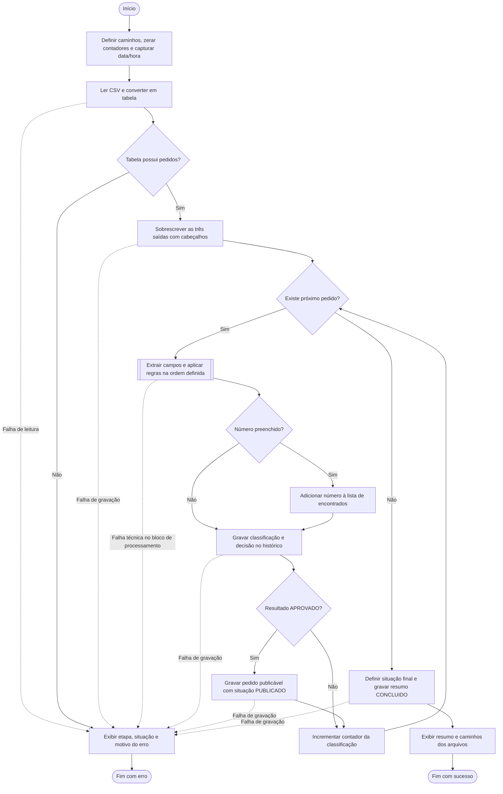
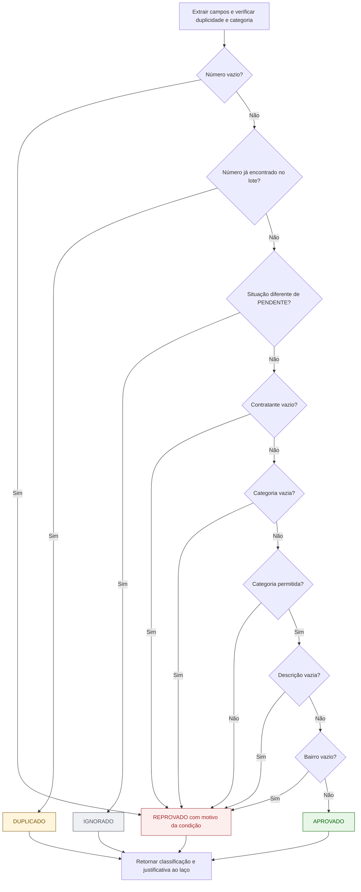

# Documentação do fluxo Power Automate — validação de solicitações

Fonte: [ações exportadas em texto](../export%20fluxo/GS_quem_faz_Automate.txt).
Nome configurado no sistema: `Quem_Faz_RPA`. Este documento descreve o processo
automatizado, arquivos, regras, exceções e critérios de conclusão.

## 1. Objetivo e escopo

O Quem Faz recebe pedidos de serviços que precisam ser conferidos antes de serem
disponibilizados aos profissionais. O robô automatiza essa conferência em lote,
classificando cada linha como `APROVADO`, `REPROVADO`, `DUPLICADO` ou `IGNORADO`,
sempre com uma justificativa. As categorias atendidas são `LIMPEZA`, `PINTURA` e `MANUTENCAO`.

O fluxo lê e escreve arquivos locais. Não publica em um marketplace, não envia
notificações e não altera a situação no CSV de entrada. `PUBLICADO` na saída significa
**apto para publicação** nesta demonstração acadêmica.

## 2. Pré-condições

- Windows, Power Automate Desktop instalado e conta conectada.
- Sessão desbloqueada para acionamento pela interface administrativa.
- Variável `pastadoprojeto` apontando para a mesma pasta usada pelo backend.
- Pastas `dados`, `resultados` e `logs` existentes e com permissão de leitura/gravação.
- Arquivo de entrada em UTF-8, separado por vírgulas e com o cabeçalho abaixo.

A [exportação textual](../export%20fluxo/GS_quem_faz_Automate.txt) contém um caminho
antigo em `Downloads`. Ajuste a ação `pastadoprojeto` antes de executar em outra pasta.
Consulte os [pré-requisitos e a configuração do fluxo](../../README.md#como-executar).

## 3. Contrato dos arquivos

| Papel | Caminho relativo | Cabeçalho, na ordem exigida |
|---|---|---|
| Entrada | `dados/pedidos_entrada.csv` | `numero_pedido,categoria,descricao,bairro,codigo_cliente,situacao` |
| Resultado de todos os pedidos | `resultados/pedidos_processados.csv` | `numero_pedido,categoria,descricao,bairro,resultado,motivo` |
| Apenas aprovados | `resultados/pedidos_publicaveis.csv` | `numero_pedido,categoria,descricao,bairro,situacao` |
| Auditoria | `logs/historico_execucao.csv` | `data_hora,etapa,numero_pedido,resultado,mensagem` |

As saídas são construídas por concatenação, sem escape de campos. Vírgulas, aspas
e quebras de linha dentro dos campos podem deslocar colunas; o cadastro pela interface
restringe esses caracteres. O código do contratante não é incluído nos arquivos de saída.

## 4. Etapas do fluxo

### 4.1 Inicialização — REGION inicializacao

1. Exibe a mensagem de início por até 3 segundos.
2. Define `pastadoprojeto` e deriva os quatro caminhos dos CSVs.
3. Define etapa, situação e motivo inicial da execução.
4. Zera os contadores `totaldepedidos`, `pedidosaprovados`, `pedidosreprovados`,
   `pedidosduplicados` e `pedidosignorados`.
5. Define `houveerro=False` e cria a lista vazia `pedidosjaencontrados`.
6. Captura a data/hora local uma única vez em `dataehoradaexecucao`, no formato
   `yyyy-MM-dd HH:mm:ss`. Todas as linhas do histórico usam essa marca.

### 4.2 Leitura — REGION leitura dos pedidos

O robô lê o texto UTF-8 e utiliza `GenerateDataTableFromCSV` com separador vírgula,
primeira linha como cabeçalho, remoção de espaços nas bordas e campos como texto.
Se a leitura/conversão falhar, o bloco de erro desvia para `FINALIZACAO_ERRO`.
Uma tabela sem linhas também encerra com erro. Até esse ponto, as saídas antigas
permanecem intactas.

### 4.3 Preparação — REGION preparacao dos arquivos

Sobrescreve os três CSVs de saída com seus cabeçalhos. O fluxo não cria as pastas.
Se não conseguir gravar, registra a situação de falha e segue para a finalização com erro.

### 4.4 Validação — REGION processamento dos pedidos

Um `LOOP FOREACH` percorre a tabela. Em cada iteração, o robô:

1. Incrementa o total e extrai os seis campos do pedido.
2. Reinicia os indicadores de duplicidade e categoria permitida.
3. Percorre a lista dos números já encontrados e marca a duplicidade, se houver.
4. Verifica se a categoria é LIMPEZA, PINTURA ou MANUTENCAO.
5. Aplica a cadeia de regras da seção 5. Apenas a primeira condição atendida determina
   a classificação e a justificativa.
6. Adiciona o número à lista de encontrados, quando preenchido, inclusive para pedidos
   reprovados, ignorados ou duplicados. Números vazios não são adicionados.
7. Grava o pedido, resultado e motivo em `pedidos_processados.csv`.
8. Grava a decisão no histórico com etapa `Validacao` e a marca de data/hora do lote.
9. Se aprovado, incrementa os aprovados e grava a linha com `PUBLICADO` em
   `pedidos_publicaveis.csv`. Nos outros casos, incrementa o contador da classificação.
10. Retorna ao laço para o próximo pedido.

Reprovações e duplicidades são resultados normais, sem interromper o lote. Uma falha
técnica no bloco interrompe o processamento e pode deixar saídas parciais.

### 4.5 Resumo — REGION conferencia e integracao com mvp

Após o último pedido, define a situação como concluída com ou sem aprovados, monta
o resumo e o grava no histórico:

```text
<data_hora>,Resumo,LOTE,CONCLUIDO,Total analisado: 11; aprovados: 4; reprovados: 5; duplicados: 1; ignorados: 1.
```

Os números acima são o resultado do lote de exemplo. Em cada execução, vêm dos contadores.
Se a gravação do resumo falhar, segue para `FINALIZACAO_ERRO`; caso contrário,
desvia para `FINALIZACAO_SUCESSO`.

### 4.6 Finalização — REGION finalizacao

- `FINALIZACAO_SUCESSO`: exibe o resumo e os caminhos das saídas por até 12 segundos.
- `FINALIZACAO_ERRO`: exibe etapa, situação e motivo do erro por até 15 segundos.

**Os dois caminhos encerram com `EXIT Code: 0`.** O código de saída não distingue
sucesso de erro; a integração precisa conferir o histórico e os CSVs.

## 5. Regras de negócio e prioridade

| Ordem | Condição | Resultado | Motivo gravado |
|---|---|---|---|
| 1 | Número vazio | REPROVADO | Numero do pedido nao informado |
| 2 | Número já encontrado no lote | DUPLICADO | Numero do pedido repetido no mesmo lote |
| 3 | Situação diferente de PENDENTE | IGNORADO | Pedido nao esta pendente de validacao |
| 4 | Contratante vazio | REPROVADO | Codigo do contratante nao informado |
| 5 | Categoria vazia | REPROVADO | Categoria nao informada |
| 6 | Categoria não permitida | REPROVADO | Categoria nao cadastrada no MVP |
| 7 | Descrição vazia | REPROVADO | Descricao do servico nao informada |
| 8 | Bairro vazio | REPROVADO | Bairro do servico nao informado |
| 9 | Nenhuma condição anterior | APROVADO | Pedido validado e disponivel aos profissionais |

A duplicidade é verificada dentro do lote atual. Um número repetido recebe DUPLICADO
mesmo que a primeira ocorrência tenha sido reprovada. A ordem também faz com que um
pedido sem número seja reprovado antes de verificar se está pendente.

## 6. Exceções técnicas

| Bloco ou condição | Situação | Consequência nos arquivos |
|---|---|---|
| Falha na leitura/conversão | Falha na leitura dos pedidos | Saídas antigas preservadas |
| Tabela sem pedidos | Arquivo de entrada sem pedidos | Saídas antigas preservadas |
| Falha na preparação | Falha ao preparar arquivos | Uma parte das saídas pode ter sido sobrescrita |
| Falha durante o laço | Falha no processamento | Saídas podem conter apenas parte dos pedidos |
| Falha ao gravar resumo | Falha ao finalizar o log | Decisões podem existir sem comprovação de conclusão |

Os quatro blocos `ON BLOCK ERROR` definem o indicador de erro, a situação e o motivo,
e desviam para a mesma etiqueta de finalização. O motivo técnico é mostrado em um
diálogo; o fluxo exportado não grava esse motivo em um JSON de status.

## 7. Fluxogramas de referência

Os diagramas Mermaid abaixo representam as ações do arquivo exportado e podem ser
renderizados pelo GitHub. São a referência para reproduzir o fluxograma em imagem.

A [imagem PNG existente](../../docs/fluxograma_power_automate.png) requer revisão:
a pergunta de categoria permitida aponta Sim para reprovação; a pergunta de bairro
vazio aponta Sim para aprovação; há também uma ligação que contorna o laço após a
preparação e outra que contorna as decisões após a verificação de duplicidade.
Essas ligações não correspondem ao fluxo exportado.

### Etapas gerais e tratamento de falhas



### Decisão individual do pedido



## 8. Integração e confirmação de conclusão

O backend prepara e arquiva o lote, registra um ID e aciona o PAD. Em seguida,
monitora o processo do robô e as alterações dos arquivos. Para confirmar a conclusão:

1. O histórico precisa ter sido alterado, com marca de data/hora compatível com o início.
2. Deve existir uma linha `Resumo,LOTE,CONCLUIDO` com a mesma marca do lote.
3. Os arquivos de processados e publicáveis precisam ter sido atualizados.
4. Total enviado, total do resumo e total de resultados precisam coincidir.
5. As contagens por classificação devem coincidir; publicáveis devem totalizar os aprovados.

Sem essas evidências, o sistema registra falha técnica ou resultado indeterminado.
Cancelar pela interface encerra apenas o monitoramento; não interrompe o PAD.
Detalhes em [arquitetura e evidências](../../README.md#arquitetura-e-evidências).

## 9. Resultado esperado e evidências

O [lote de exemplo](../../tests/dados_teste/pedidos_entrada.csv) possui 11 pedidos:
4 aprovados, 5 reprovados, 1 duplicado e 1 ignorado. Os publicáveis são PED-001,
PED-002, PED-003 e PED-008.

- [Classificação esperada por linha](../../tests/dados_teste/resultado_esperado.csv).
- [Saídas preservadas do PAD](../../tests/dados_teste/saida_real_2026-11-10/).
- [Amostra do histórico](../../logs/amostras/historico_execucao_exemplo.csv).
- [Captura da conclusão](../../assets/automate3.png).
- [Captura do erro de leitura](../../assets/automate4%20%28erro%29.png).
- [Instruções para reproduzir os testes](../../README.md#testes).
